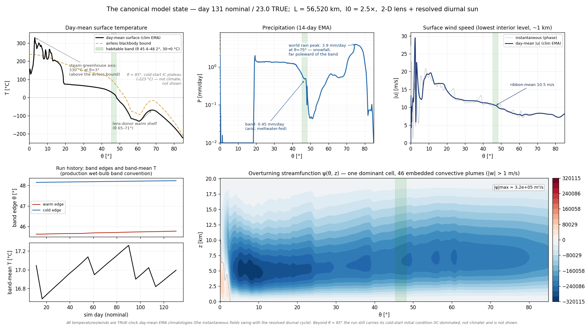
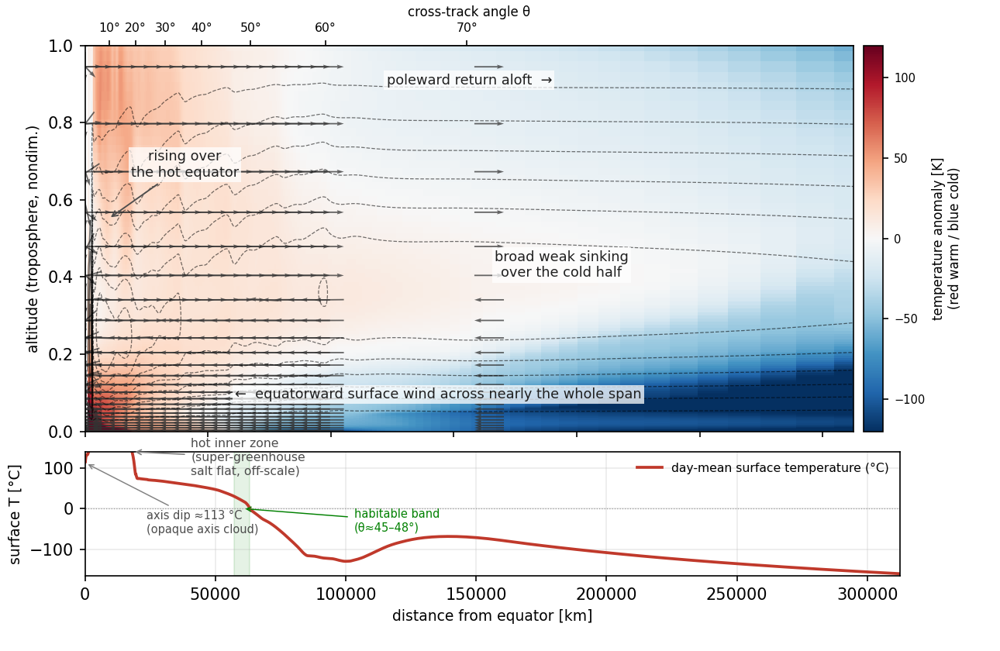

# flatworld

An atmosphere and climate model for a fictional world, written for a personal worldbuilding project.
The world is an infinite flat plane, not a planet: a train of suns moves along one straight track at a
fixed height above it, and nothing rotates. The code applies standard atmospheric physics to that
geometry and predicts temperature, circulation, clouds and precipitation from the sun geometry and a
land/sea map.



## What it computes

- **Inputs:** the sun geometry (height `L` of the suns, brightness `I0`) and a topography (land/sea mask
  plus elevation), either generated procedurally or supplied as arrays or an `.npz` file.
- **Outputs:** the cross-track circulation and temperature structure in a vertical `(x, z)` slice, and 2-D
  `(x, e)` maps (cross-track by along-track) of time-mean surface temperature, diurnal temperature range,
  precipitation and a seasonless Köppen classification.

The cross-track coordinate is `x = L·tan θ`, where θ is the angle from the sun track. Grids are laid
out in physical distance `x`, not uniformly in θ.

## Physics

**Forcing** (`flatworld/geometry.py`). The instantaneous flux from one sun follows
`I0·cos³θ·exp[−τ0(sec θ − 1)]` (incidence angle, inverse-square distance, slant-path haze). The
day-mean flux has no closed form; it is computed by integrating the passage of the moving train of
suns. The Coriolis parameter is exactly zero, so there is no geostrophic balance and no Ekman layer;
the structure of the overturning circulation is computed, not assumed.

**Dynamical core** (`flatworld/stage_ad_core.py`, `stage_ad_kernels.py`, `stage_ad_config.py`).
A 2-D `(x, z)` anelastic model in vorticity–streamfunction form:

- anelastic mass continuity with a hydrostatic reference density `ρ_ref(z)`; the streamfunction comes from
  a `ρ_ref`-weighted elliptic solve (sparse LU, or a DST-based separable fast solver);
- buoyancy computed from absolute (virtual) temperature, with the stratification diagnosed rather
  than prescribed;
- Smagorinsky eddy viscosity and diffusivity, plus surface drag;
- two vertical grids: a pressure grid for the column physics and a height grid for the dynamics,
  reconciled hydrostatically every step;
- `ψ = 0` at the equatorial symmetry edge and at the poleward wall, so no energy is carried out
  laterally and the only export is outgoing longwave radiation;
- options for a stretched, boundary-layer-refined vertical grid and a stretched cross-track grid,
  flux-form upwind or flux-limited tracer advection, and implicit vertical advection/diffusion;
- a CFL-adaptive time step, operator-split between the dynamics and the column physics; the column
  physics can be sub-cycled within each step.

**Radiation** (`flatworld/radiation.py`). A semi-gray two-stream scheme: longwave optical depth from the
water-vapour path plus a well-mixed component, with an atmospheric-window channel; shortwave with
surface albedo and optional diffuse and two-band treatments. Clouds are radiatively active, with
optical depth derived from the cloud water path.

**Convection, clouds and precipitation** (`flatworld/stage_ad_column.py`, `bl_cloud.py`,
`stage_ad_core.py`). A moist convective adjustment that conserves column enthalpy and water exactly,
with an optional finite relaxation time (Betts–Miller style). Prognostic cloud condensate with
Kessler-type autoconversion for liquid and ice, rain sedimentation, and re-evaporation below cloud. A
boundary-layer stratocumulus closure for decks under a subsidence inversion.

**Surface** (`flatworld/surface.py`, `stage_ad_core.py`). A prognostic surface energy balance with bulk
aerodynamic sensible and latent heat fluxes. The diurnal cycle is resolved where it matters: because
`σT⁴` is nonlinear, the time-mean temperature of a strongly cycling surface sits below its radiative-mean
temperature, and the model carries that difference rather than using day-mean forcing directly.
Optional prognostic surface water and salt budgets.

**Map stage** (`flatworld/climate_map.py`). Carries the backbone's temperatures and moisture supply onto
a 2-D `(x, e)` map over the topography: a damped, diagnostic balanced boundary-layer wind (f = 0) and a
two-layer moisture budget (surface and aloft), with a resolved land diurnal cycle.
`flatworld/classify.py` turns the resulting temperature and precipitation into a Köppen-style
classification adapted for a world without seasons.

**Simpler backbone.** `stage_a_column.py` (a chain of radiative–convective columns coupled by diffusive
heat transport) and `stage_b_overturning.py` (a nondimensional Boussinesq overturning solver) form an
older, cheaper A → B → C cascade. Stage A has no resolved flow; it removes heat at its cold edge
through a radiating sponge rather than closed walls. The cascade is kept as a fast regression path
and as a sweep engine.

**GPU.** An optional CuPy backend (`flatworld/device.py`, `flatworld/_gpu_kernels.py`) runs the anelastic
core on an NVIDIA GPU. The CPU path and the test suite do not need CuPy.

## Numerics and verification

What the code checks, and where:

- **Conservation diagnostics** on the anelastic core: domain energy balance with no lateral export term,
  the anelastic continuity residual, and a cumulative column-water residual that accounts for every
  source and sink (`StageADCore.energy_conservation`, `mass_conservation`, `water_conservation`).
- **Independent reference solutions** that do not share the core's time loop: a standalone
  single-column radiative–convective equilibrium (`single_column_rce`), an algebraic root-find of the
  surface energy balance to compare against the core's integrated surface temperature
  (`bulk_air_sea_sst`), a Rayleigh–Bénard run of the same dynamical kernel to compare the Nusselt–Rayleigh
  scaling exponent with published values (`rayleigh_benard_run`, `nu_ra_scaling`), and the analytic gray
  radiative-equilibrium limit for the radiation scheme.
- **Convergence as a stopping condition.** Runs stop when a documented steady-state metric falls below
  tolerance, with an iteration or time guard and checkpointing so a guarded run resumes rather than
  restarts (`flatworld/convergence.py`). For the turbulent core, where pointwise drift never settles,
  `flatworld/converged_run.py` uses a time-averaged estimator whose tolerance is set by the measured noise
  floor (integrated autocorrelation time and effective sample size).
- **Refusing truncated solves.** The map stage records how every solve stopped (converged, iteration cap,
  time guard) in its output. A route that writes a deliverable refuses an unconverged stop unless the
  operator explicitly overrides it, and the override is recorded in the product
  (`flatworld/stagec_convergence.py`).
- **Grid convergence.** `flatworld/gci.py` implements Richardson extrapolation and the Grid Convergence
  Index (Celik et al. 2008) for three-level resolution studies, including the observed order of
  convergence and an asymptotic-range check.
- **Provenance.** Checkpoints carry a fingerprint of the model configuration and of the forcing
  parameters that are fixed at import time; on resume the fingerprint is compared against the running
  process and mismatches are reported or refused (`flatworld/_ckpt_fingerprint.py`).
- **Tests.** `flatworld/tests/` holds about 1,000 unit and regression tests covering the above, run with
  pytest.

## Quick start

Tested with Python 3.12 (the parent project runs 3.11).

```bash
python -m venv .venv
.venv/bin/pip install -r requirements.txt

# Low-resolution run of the cheap A -> B -> C cascade over a procedurally generated continent.
# About a minute on a desktop CPU; prints a summary and writes cascade_test.npz.
.venv/bin/python -m flatworld.cascade test 3

# The same pipeline with the anelastic core as the backbone, at the test profile.
# One to two minutes. The core runs a fixed, short step budget here, so the result is not converged.
.venv/bin/python -c "from flatworld.cascade import run_cascade; run_cascade(profile='test', topo_seed=3, core='ad')"

# Test suite, skipping the three tests marked slow. With pytest-xdist on 24 cores this took about
# 4 minutes (1,009 passed; the skips are GPU-only tests and a few that need files from the parent
# project); it takes considerably longer serially.
.venv/bin/python -m pytest -m "not slow" -q          # add -n auto with pytest-xdist installed
```

The code defaults are a small test configuration (`L` = 20,000 km, coarse grids, simplified physics
switches). Production settings are selected through `COSMO_*` environment variables. Several of them
are read when `flatworld` is first imported, so they must be set in the shell before Python starts.

## Figures

Both figures come from the project's current production run (`L` = 56,520 km, a 975 × 144 stretched
grid, GPU, double precision). They cannot be regenerated from this repository, which does not include
the production driver or its checkpoint.

The top figure shows day-mean surface temperature, precipitation and surface wind against θ, the
history of the edges of the habitable band (where day-mean surface temperature lies between 0 and
30 °C), and the overturning streamfunction. The figure below is a
cross-section of the overturning circulation: rising air over the hot sun track, poleward return flow
aloft, broad sinking over the cold side, and the surface temperature profile beneath it.



## Status

A personal project, in active development. Known open issue: in the current production state the lowest
one to two kilometres are statically unstable equatorward of about 50°, because the run caps the
convective adjustment at four sweeps per call, which is not enough on the 144-level grid. Measurements so
far show it moves the warm edge of the habitable band by about half a degree; whether to re-run the
production state is still open.

This repository contains the model package and its tests. The production run driver and launch
scripts, checkpoints, the geology and landscape-evolution code, campaign tooling, and the analysis and
figure scripts belong to the larger private project and are not included. Code paths that need them
(the `tectonic` and `lem` topography options, and loading a named production checkpoint into the
cascade) raise `ImportError` here. Some docstrings and comments refer to design notes and issue numbers
from that project.
